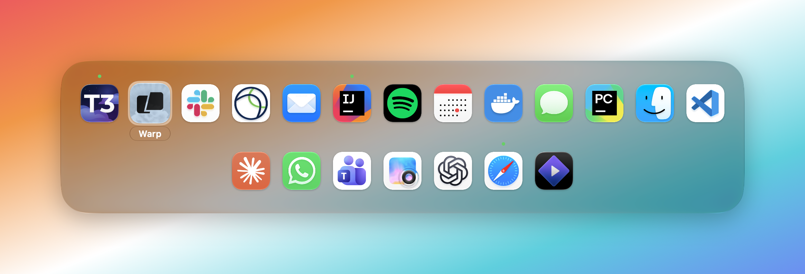
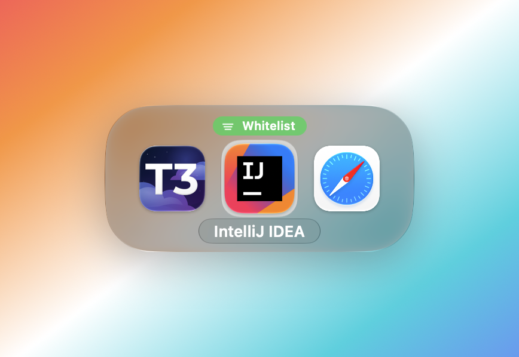

# mac-utilities

Self-built macOS utilities, hosted as toggleable features of one menu bar app,
`MacUtilities.app`. The features share one event tap, one Accessibility grant and
one login item. Swift Package, no Xcode project.

## Menu bar item and settings

Clicking the menu bar item opens a popover in the style of Control Center, drawn as
Liquid Glass. Its header, beside the app icon, says whether the shortcuts are live:
"All shortcuts active" by a green dot, "Paused — keys pass through untouched" by an
indigo one, or "Shortcuts off — see Settings" by an orange one while the event tap is
not running. Below it sit rounded tiles, most with a round button filled with a colour
while its tile is on: Pause Shortcuts, which lets every key press through untouched
until it is toggled off again, then the tiles of the enabled features, such as Keep
Awake or the App Switcher's Batch Quit.
Settings… (Cmd+,) opens the settings window, on General while the shortcuts are off,
and Quit (Cmd+Q) quits.

Showing the popover activates the app, so it takes clicks and keys at once. A click
elsewhere, another click on the item or Esc closes it; after Esc the app that was in
front before gets the keyboard back.

The settings window lists General, then one row per feature below a gap, in a
sidebar, each with its icon tile, and shows the selected pane beside it; the window's
title follows the pane. A row shows its pane the moment it is pressed, not when the
mouse is released, and the arrow keys move between rows. The window and every pane
are built at launch and kept, so opening it or switching panes never waits on
building one. It opens at 720 by 540 points and can be made larger, or shorter down
to 420.

A feature's pane opens with its icon, its name, one line on what it does and the
switch that turns it on or off. A feature switched off stops on the spot and stays
off across launches; the rest of its pane is faded and disabled until it is back on.

General opens with the app's card: how many features are on, and each feature's icon,
faded while it is off, which opens its pane when clicked. Below it are a "Launch at
login" switch, which the app switches on by itself on its first launch only, and the
Accessibility grant. The event tap every shortcut depends on needs the grant and is
only created at launch, so until it runs a warning card sits above them and the
General row in the sidebar carries a warning badge. While the grant is missing, the
card says no shortcut works without it and has a button to the Privacy & Security >
Accessibility pane; once granted, it offers Reopen MacUtilities, which quits the app
and opens it again. With the tap running, a checkmark row says access is allowed. The
grant is re-checked whenever the window comes back to the front. Every change applies
immediately.

## Features

### app-switcher

Replaces Cmd+Tab with a switcher that can be filtered to a whitelist of apps, and
Cmd+` with the same panel showing thumbnails of the current app's windows (needs
Screen Recording permission for the thumbnails). See
[docs/app-switcher](docs/app-switcher/README.md) for the shortcuts and the smoke test.





### keep-awake

A Keep Awake tile in the menu bar popover that holds a power assertion and, when
wanted, disables sleep with the lid closed through `pmset`; it counts down live when
set to turn itself off. See [docs/keep-awake](docs/keep-awake/README.md) for the
sudoers line it needs and what is restored on quit or crash.

### hotkeys

Global shortcuts that open or toggle an app, run a shell command or toggle keep-awake,
kept in `~/.config/mac-utilities/hotkeys.json` and edited in the Hotkeys pane, which
records combos, shows them as keycaps, picks apps with their icons and warns about
taken keys. See [docs/hotkeys](docs/hotkeys/README.md) for the file format and the
actions.

### microphone

A Microphone tile and settings selector that choose any connected audio input as
the Mac's default: built-in, USB, Bluetooth or iPhone. The controls show the current
microphone and update when devices or the system default change. Restore the
previous input from the tile or settings; disabling the feature or quitting also
restores it while it is available. See
[docs/microphone](docs/microphone/README.md) for selection and restoration behavior.

## Install

```sh
./install.sh
```

Builds the app, copies it to `~/Applications` and launches it. It also asks for your
password once to install `/etc/sudoers.d/mac-utilities-pmset`, the line that lets
keep-awake run `pmset -a disablesleep` without a prompt. The app asks for
Accessibility once on first launch.

The first launch from `~/Applications` or `/Applications` also registers the app as a
login item through `SMAppService`, listed under System Settings > General > Login
Items. macOS holds a self-signed app there until it is allowed, so if it asks, the
app opens Settings > General, which says "Waiting for approval under Login Items" with
a button to that pane. The app registers itself only on that one launch: switching
"Launch at login" off in Settings > General stays off. An install from before this
behavior has no record of a first launch, so its next launch counts as the first one
and registers the login item unless it is already on; switch it off once to keep it
off. A build run from anywhere else, such as the repository folder for the smoke
tests, never registers itself and does not count as the first launch.
`./uninstall.sh` stops the app, restores normal sleep and removes the copy and the
sudoers line; switch the login item off first, or remove the stale entry from Login
Items afterwards.

## Build

For development, without installing:

```sh
./build.sh
open MacUtilities.app
```

`build.sh` runs `swift build -c release`, wraps the binary into `MacUtilities.app`
with the icon from `Resources/AppIcon.icns` and signs it with the "mac-utilities"
certificate, so macOS keeps the granted Accessibility permission stable across
rebuilds.

Always launch with `install.sh`, the login item or `open MacUtilities.app`. Running
the binary directly from a terminal makes the terminal the responsible process for
the Accessibility permission, and the event tap fails.

To check the settings window without installing, open it once, capture every pane to
`/tmp/settings-<pane>-smoke.png` and exit:

```sh
SETTINGS_SMOKE_TEST=1 ./MacUtilities.app/Contents/MacOS/MacUtilities
```

Pointing `XDG_CONFIG_HOME` at a directory holding a sample
`mac-utilities/hotkeys.json` captures the Hotkeys pane with those bindings, and at an
empty one its empty state, without touching your own file.

To check the menu bar popover the same way, open it under the instance's own menu
bar item, capture it to `/tmp/menu-bar-smoke.png` and exit:

```sh
MENU_BAR_SMOKE_TEST=1 ./MacUtilities.app/Contents/MacOS/MacUtilities
```

The app icon, three frosted glass tiles cascading on a midnight blue body with a ⌘
key in front, is drawn in code by `scripts/render-app-icon.swift`; the menu bar
glyph is the same three tiles. `Resources/AppIcon.icns` is the script's committed
output, so a build needs no extra step. After changing the script, re-render the icon
and rebuild:

```sh
swift scripts/render-app-icon.swift
./build.sh
```

The script draws every size from the same 1024pt canvas into
`.build/AppIcon.iconset` and runs `iconutil` on it. At 32 pixels, 16pt on a Retina
screen, the tiles fan out further and drop the ⌘. There are no 16 and 32 pixel 1x
sizes: `iconutil` stores those in a legacy format that macOS 26 draws shrunk inside a
gray frame, while without them it scales the 64 pixel one down.

## Setup

Run `./create-signing-cert.sh` once. It creates a self-signed "mac-utilities" certificate that `build.sh` signs with, so rebuilt apps keep their Accessibility permission. If a rebuilt app asks for permission again, run `tccutil reset Accessibility com.ulvifk.mac-utilities` and grant it once more.

## Layout

```
Sources/MacUtilities/
  main.swift          assembles the app: the preferences, the menu bar interface, the
                      features and the controller that hosts them
  Core/               the host: the Feature protocol, AppController (feature lifecycle,
                      pause, event dispatch, the first launch's login item), the
                      EventTap, AppInterface and LoginItem boundaries, the CoreGraphics
                      tap, key matching, Preferences, Accessibility trust, window
                      capture for the smoke tests
  MenuBar/            the menu bar item and glyph, its popover, the tile and round
                      button row its tiles are built from, and the menu bar smoke test
  Settings/           the settings window: its sidebar, the pane selection that tells
                      features when their pane is visible, the header and switch opening
                      every feature's pane, the General pane, the icon tiles and keycaps
                      the panes share, and the settings smoke test
  Features/<Name>/    one folder per feature
scripts/              test.sh, which runs the tests, and render-app-icon.swift, which
                      draws the app icon
Resources/            AppIcon.icns, the rendered app icon that build.sh bundles
docs/<name>/          the feature's README and screenshots
```

A feature implements `Feature`: a stable `identifier` (the key its enabled state is
stored under), a `displayName`, a one-sentence `summary`, an `iconSymbolName` and
`iconGradient` for its icon tile in the settings window, and
`buildSettingsSections() -> AnyView`, the sections of its settings pane below the
header. The rest have defaults that do nothing, so a feature implements only what it
needs: `start()` and `stop()`, `handle(type:event:) -> Bool`, which swallows the event
when it returns `true`, `prepareForTermination()` for cleanup Quit waits on,
`settingsWindowChanged(_:)`, the settings window while it shows the feature's pane,
and `buildPopoverTile() -> AnyView?`, its tile in the menu bar popover while it is
enabled; a tile observes its feature or the stores it shows and keeps itself current.
The popover lists the tiles in the features' order. The core tap hands every key press
and modifier change to the enabled features in order; the first one returning `true`
swallows the event. Enabled features are stopped when the app quits.
Switched-off features are stored in UserDefaults under `disabledFeatures`, so a
feature runs until it is switched off, new ones included. New features are
registered in `main.swift`.

## Reading the log

The app writes to the unified log under the subsystem `com.ulvifk.mac-utilities`, with
one category per feature: `keep-awake`, `hotkeys`, `app-switcher`, `microphone`, plus
`core` for launch, Accessibility, the event tap, features starting and stopping and the
first launch's login item registration.
State changes and their causes are logged at notice level, so macOS keeps them on disk;
failures at error level. To read the last hour:

```sh
log show --last 1h --predicate 'subsystem == "com.ulvifk.mac-utilities"'
```

For live output, `log stream` takes the same predicate:

```sh
log stream --predicate 'subsystem == "com.ulvifk.mac-utilities"'
```

Add `and category == "keep-awake"` to the predicate for one feature. A hotkey's shell
command is logged as private and shows as `<private>`.

## Development

Run the tests with:

```sh
./scripts/test.sh
```

Arguments go on to `swift test`, such as `--filter SystemAudioInputTests`. The script
exists because the Command Line Tools keep the Swift Testing macro plugin outside the
compiler's default plugin path, so plain `swift test` fails to build the tests without
Xcode; the script passes the path when it is there.

The tests follow one convention: whatever reaches the operating system, such as
CoreAudio, the event tap, UserDefaults, the login item or the menu bar, sits behind a
protocol or a parameter that the code receives, and `main.swift` passes the real ones.
Tests build the code in-process with `@testable import MacUtilities` and fakes from
`Tests`, so they never change the Mac's settings, show a window or write the app's
defaults.
Nothing compiles sources by hand. Quitting ends the process, so the termination tests
run the real `NSApplication` in Swift Testing exit tests, child processes of the test
runner.

Tests wait with the helpers in `Tests/MacUtilitiesTests/MainQueueWaiting.swift`. Work on
the main queue is awaited with `waitUntil`, `waitForResult` and, before checking that
something did not happen, `letMainQueueRun`. They count main queue turns, not time, so a
busy machine or a test holding the main thread cannot make a wait fail; the turn limit
only turns a hang into a failure. Only events from outside the main queue, such as a file
system notification or a child process, are awaited against the clock, with
`waitForOutsideEvent`, whose 60-second limit exists for the same reason.
